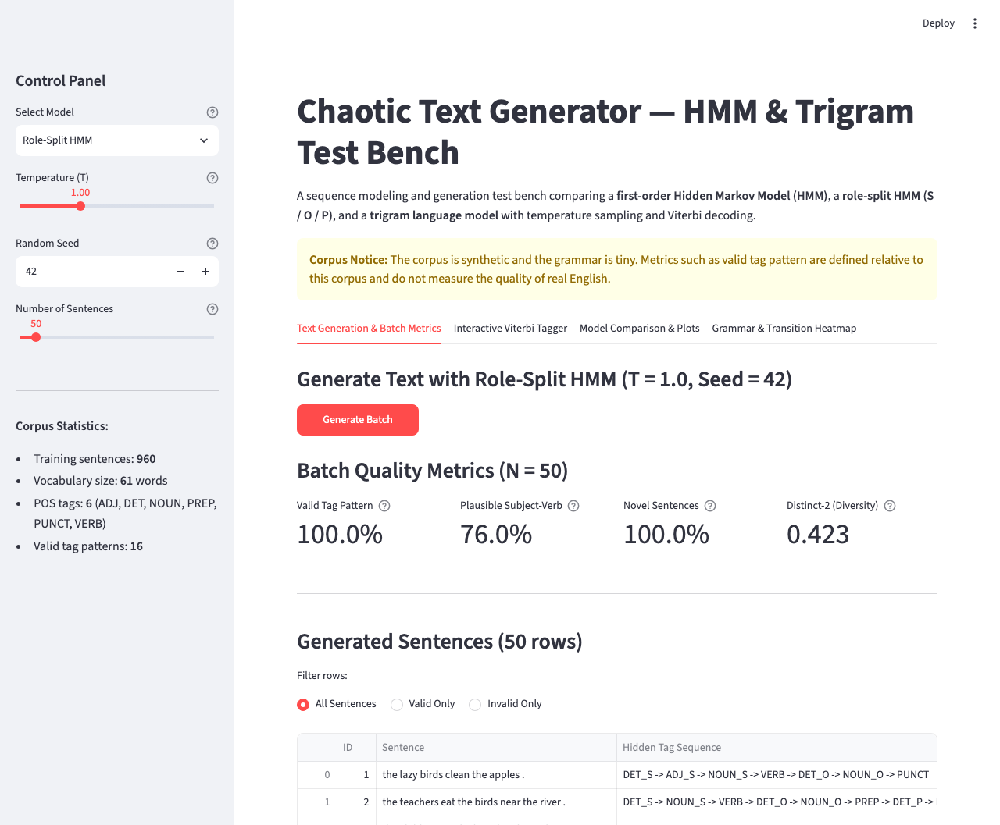
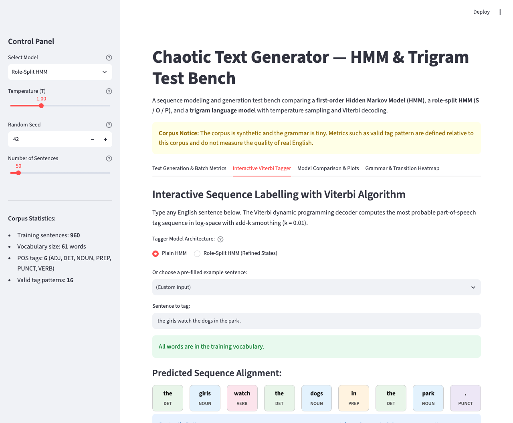
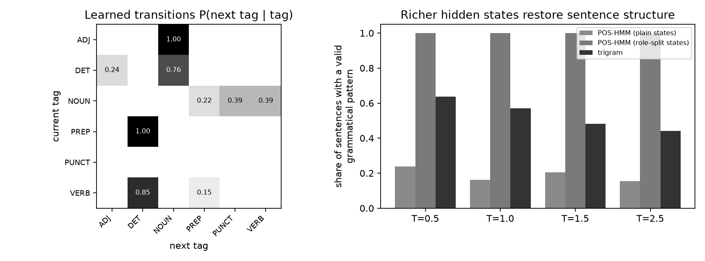

# Chaotic Text Generator & Sequence Labelling Test Bench
### Hidden Markov Model (POS-HMM), Role-Split States, Viterbi Decoding, and Trigram Baseline

[](https://www.python.org/)
[](https://streamlit.io/)
[](https://creativecommons.org/licenses/by-sa/4.0/)
[](https://github.com/ImaneMekkaoui1)
[](tests/test_pipeline.py)

**Author:** [Imane Mekkaoui](https://github.com/ImaneMekkaoui1)  
**Repository:** [Hmm-trigram-text-generator](https://github.com/ImaneMekkaoui1/Hmm-trigram-text-generator)  
**Full Technical Report:** [Rapport_TP03_Chaotic_Text_Generator.pdf](Rapport_TP03_Chaotic_Text_Generator.pdf)

---

## Table of Contents

- [Overview](#overview)
- [Key Architectural Concepts](#key-architectural-concepts)
  - [1. Plain First-Order POS-HMM](#1-plain-first-order-pos-hmm)
  - [2. Role-Split HMM (Syntactic Memory)](#2-role-split-hmm-syntactic-memory)
  - [3. Trigram Baseline with Back-Off](#3-trigram-baseline-with-back-off)
  - [4. Viterbi Dynamic Programming Decoder](#4-viterbi-dynamic-programming-decoder)
  - [5. Temperature-Controlled Sampling](#5-temperature-controlled-sampling)
- [Application Screenshots & Features](#application-screenshots--features)
- [Quantitative Benchmark Results](#quantitative-benchmark-results)
  - [Synthetic Corpus Evaluation (T = 1.0, N = 500)](#synthetic-corpus-evaluation-t--10-n--500)
  - [Temperature Sensitivity & Engineering Trade-Offs](#temperature-sensitivity--engineering-trade-offs)
  - [Failure Taxonomy & Qualitative Analysis](#failure-taxonomy--qualitative-analysis)
  - [Real-World Benchmark: Universal Dependencies English EWT](#real-world-benchmark-universal-dependencies-english-ewt)
- [Automated Unit Tests](#automated-unit-tests)
- [Repository Structure](#repository-structure)
- [Quickstart and Reproduction](#quickstart-and-reproduction)
- [Cloud Deployment](#cloud-deployment)
- [Synthetic Corpus Notice](#synthetic-corpus-notice)

---

## Overview

Text generation without ground truth requires principled evaluation over hundreds of sampled sentences rather than anecdotal observation. Conversely, sequence labelling (part-of-speech tagging) recovers the hidden grammatical structure behind an observed sequence.

This project implements an interactive probabilistic test bench that:
1. **Generates text** using supervised sequence models: a **first-order Hidden Markov Model (HMM)**, a **role-split HMM**, and an **n-gram (trigram) baseline**.
2. **Evaluates generation quality** across four automated metrics: **Valid Tag Pattern**, **Plausible Subject-Verb**, **Novel Sentences** (anti-memorisation), and **Distinct-2** (lexical diversity).
3. **Labels sequences** via the **Viterbi algorithm** in log-space with add-k smoothing, resolving structural ambiguities (such as *watch* as NOUN vs VERB) and gracefully handling Out-of-Vocabulary (OOV) tokens.
4. **Benchmarks real-world robustness** using the Universal Dependencies English EWT treebank (17 UPOS tags, 12,544 sentences).

---

## Key Architectural Concepts

### 1. Plain First-Order POS-HMM
- **Hidden states:** Part-of-speech tags `t in {DET, NOUN, VERB, ADJ, PREP, PUNCT}`.
- **Observations:** Words `w in V` (|V| = 61).
- **Parameters:** Estimated by direct counting (no iterative gradient descent):
  - Initial probabilities: `P(t_1)`
  - Transition probabilities: `P(t_i | t_{i-1}) = count(t_{i-1}, t_i) / count(t_{i-1})`
  - Emission probabilities: `P(w_i | t_i) = count(t_i, w_i) / count(t_i)`
- **Structural limitation:** Under the first-order Markov assumption, the next state depends solely on the current state. After `NOUN`, the model cannot determine whether the noun is the **subject** (which must be followed by `VERB`) or the **object** (which is followed by `PREP` or `PUNCT`). In the training data, after `NOUN`, the next tag is `VERB` with probability 0.39, `PUNCT` with 0.39, and `PREP` with 0.22. This lack of phase memory causes the plain HMM to generate severely broken syntactic structures (only **16.2%** valid patterns).

### 2. Role-Split HMM (Syntactic Memory)
To overcome the first-order limitation without leaving the counting paradigm, **state splitting** refines every `NOUN`, `ADJ`, and `DET` according to its clause-level syntactic role:
- `_S` : Before the verb (**Subject**)
- `_O` : After the verb (**Object**)
- `_P` : Inside the prepositional phrase (**Prepositional object**)

Canonical role-split sequence:
```text
DET_S NOUN_S VERB DET_O NOUN_O PREP DET_P NOUN_P PUNCT
```

By conditioning transitions on roles:
- `P(VERB | NOUN_S) = 1.0`
- `P(VERB | NOUN_O) = 0.0`

The model gains the structural memory it lacked, increasing valid syntactic patterns from **16.2% to 100.0%**.

### 3. Trigram Baseline with Back-Off
A lexical n-gram model that predicts the next word directly from the two preceding words:
```text
P(w_i | w_{i-2}, w_{i-1})
```
With hierarchical back-off: Trigram -> Bigram -> Unigram when a context is unseen. It excels at local semantic collocations (**76.0%** plausible subject-verb pairs) but frequently violates global clause structure (**57.0%** valid patterns) and is prone to training memorisation (**8.8%** copied verbatim at T = 1.0).

### 4. Viterbi Dynamic Programming Decoder
Computes the most probable hidden state sequence using dynamic programming in log-space:

```text
v_i(t) = max_p [ v_{i-1}(p) + ln P(t | p) ] + ln P(w_i | t)
```

Add-k smoothing (k = 0.01) ensures non-zero emission probabilities for unseen test words:
```text
P(w | t) = (count(t, w) + k) / (count(t) + k * |V|)
```

### 5. Temperature-Controlled Sampling
Controls generation diversity and predictability by reshaping sampling counts with temperature T > 0:
```text
weights = count^(1 / T)
```
- **T < 1.0 (Sharpening):** Concentrates probability mass on dominant frequencies (conservative, highly predictable, prone to memorisation).
- **T > 1.0 (Flattening):** Distributes probability mass toward uniform entropy (diverse, surprising, chaotic).

---

## Application Screenshots & Features

The application (`app.py`) provides an interactive web test bench built with Streamlit.

### 1. Batch Generation & Quality Metrics
Displays generated sentences in an interactive table with hidden tag sequence, validity marks, filter controls, and real-time calculation of the 4 batch metrics.



### 2. Interactive Viterbi Sequence Tagger
Allows typing arbitrary sentences with visual word-to-tag alignment cards, lexical ambiguity resolution (such as *watch* as NOUN vs VERB), and non-crashing Out-of-Vocabulary (OOV) warnings.



### 3. Multi-Model Comparison & Learned Transitions
Compares the models across multiple temperatures and provides a transition probability heatmap.



---

## Quantitative Benchmark Results

### Synthetic Corpus Evaluation (T = 1.0, N = 500)
Evaluated on 500 sentences generated with fixed seed 42 against the 960 training sentences:

| Model Architecture | Valid Tag Pattern | Plausible Subject-Verb | Novel Sentences | Distinct-2 (Diversity) |
|---|:---:|:---:|:---:|:---:|
| **Plain HMM (Coarse States)** | 16.2% | 14.8% | 99.8% | **0.198** |
| **Role-Split HMM (Refined States)** | **100.0%** | 60.6% | **99.4%** | 0.148 |
| **Trigram Baseline** | 57.0% | **76.0%** | 91.2% | 0.105 |

### Temperature Sensitivity & Engineering Trade-Offs

| Model | Metric | T = 0.5 (Safe) | T = 1.0 (Neutral) | T = 1.5 (Creative) | T = 2.5 (Chaotic) |
|---|---|:---:|:---:|:---:|:---:|
| **Role-Split HMM** | Valid Tag Pattern | 100.0% | 100.0% | 100.0% | 100.0% |
| | Plausible Subj-Verb | 69.8% | 60.6% | 56.2% | 52.2% |
| | Distinct-2 (Diversity) | 0.107 | 0.148 | 0.161 | 0.167 |
| | Novel Sentences | 99.6% | 99.4% | 99.4% | 99.8% |
| **Trigram Baseline** | Valid Tag Pattern | 63.6% | 57.0% | 48.2% | 44.2% |
| | Plausible Subj-Verb | 79.2% | 76.0% | 69.8% | 68.6% |
| | Distinct-2 (Diversity) | 0.095 | 0.105 | 0.115 | 0.112 |
| | Novel Sentences | 90.6% | 91.2% | 93.2% | 92.8% |

#### Recommended Operational Settings:
- **Writing Toy (T = 1.5):** Prioritizes stylistic surprise and lexical richness (Distinct-2 reaches 0.161) while retaining **100.0%** syntactic stability through role-splitting.
- **Autocomplete Feature (T = 0.5):** Requires low entropy and dependable subject-verb collocations (**79.2%** plausibility in trigram, **69.8%** in role-split) to prevent user confusion.

---

### Failure Taxonomy & Qualitative Analysis

Generated sentences from `results/failures.txt` reveal three distinct failure modes:

1. **Semantic Failure (Meaning):**  
   *Sentence:* `the foxes lose by the school .` (Role-Split HMM, T = 1.0)  
   *Diagnosis:* Syntactically valid (`DET_S NOUN_S VERB PREP DET_P NOUN_P PUNCT`), but semantically unnatural.  
   *Root Cause:* Hidden states represent grammatical roles, not lexical semantics. Verb emission `P(w | VERB)` is conditionally independent of the subject noun.
2. **Memorisation Failure (Copying):**  
   *Sentence:* `the girls leave the park .` (Trigram, T = 0.5)  
   *Diagnosis:* Verbatim duplicate of an existing training sentence (novelty drops to 90.6%).  
   *Root Cause:* Low temperature heavily concentrates trigram probabilities, driving deterministic copying of frequent training paths.
3. **Structural Failure (Syntax):**  
   *Sentence:* `the quiet dogs fear .` (Plain HMM, T = 1.0)  
   *Diagnosis:* Transitive verb *fear* followed immediately by `PUNCT` without an object.  
   *Root Cause:* Coarse `VERB` state allows direct transitions to `PUNCT` based on intransitive verbs (*sleep, run*).

---

### Real-World Benchmark: Universal Dependencies English EWT

The exact same HMM and Viterbi code was evaluated on real web text from the **Universal Dependencies English EWT Treebank** (12,544 train sentences, 2,077 test sentences, 17 UPOS tags, 16,654 words):

| Model / Baseline | Overall Accuracy | Known Words | Unknown Words (OOV) | Full Sentences Correct |
|---|:---:|:---:|:---:|:---:|
| **Most-Frequent Tag (Baseline)** | 86.2% | 90.8% | 28.6% | 31.9% |
| **HMM + Viterbi (1st-Order)** | **88.1%** (+1.9 pts) | **92.9%** (+2.1 pts) | 28.2% (-0.4 pt) | **40.4%** (+8.5 pts) |

#### Analysis of the Performance Gap (Synthetic vs Real):
1. **Combinatorial Explosion:** 10,359 distinct tag sequences in training (vs. 16 in the synthetic corpus). The concept of a "valid pattern" ceases to be measurable.
2. **Out-of-Vocabulary (OOV) Tokens (7.5%):** Add-k smoothing (k = 0.01) produces emission probabilities inversely proportional to tag frequency. As a result, unknown proper nouns (`PROPN`) are frequently mislabelled as `X` (195 times) or `INTJ` (137 times).
3. **Long-Distance Dependencies:** Natural language features subordinate clauses, parentheticals, and distant agreement that violate the first-order Markov assumption.

---

## Automated Unit Tests

An automated test suite is provided in `tests/test_pipeline.py`. It verifies corpus splitting, state refinement, Viterbi accuracy, OOV handling, 100% valid pattern rate under role-splitting, and metric functions.

### Running the Tests
```bash
python -m unittest discover -s tests
```

### Test Output
```text
.......
----------------------------------------------------------------------
Ran 7 tests in 0.089s

OK
```

---

## Repository Structure

```text
Hmm-trigram-text-generator/
├── app.py                     # Streamlit web test bench (Generation, Viterbi, Metrics)
├── capture_app.py             # Headless Chrome script for automated UI screenshots
├── requirements.txt           # Python dependencies for local run & Streamlit Cloud
├── README.md                  # Comprehensive documentation and benchmark report
├── Rapport_TP03_Chaotic_Text_Generator.pdf # Full 4-page academic technical report
├── screenshot_generation.png  # UI screenshot: Batch Generation and Metrics
├── screenshot_tagger.png      # UI screenshot: Interactive Viterbi Sequence Tagger
├── screenshot_comparison.png  # UI screenshot: Multi-model comparison
├── tests/
│   └── test_pipeline.py       # Automated unit test suite (7 tests)
├── data/
│   ├── corpus.csv             # Synthetic tagged corpus (1,200 sentences, 60 documents)
│   └── make_data.py           # Synthetic corpus generator script (seed 42)
├── src/
│   ├── pipeline.py            # HMM, Role-Splitting, Viterbi, Trigram, and Metric engines
│   ├── evaluate.py            # Synthetic corpus evaluation runner (writes metrics.json)
│   └── evaluate_real.py       # UD English EWT evaluation runner (writes ewt_results.json)
└── results/
    ├── hmm_results.png        # Generated plot: Transition heatmap & bar chart
    ├── metrics.json           # Serialized synthetic evaluation metrics
    ├── ewt_results.json       # Serialized real-world treebank evaluation metrics
    ├── failures.txt           # Extracted qualitative generation failure cases
    └── run_log.txt            # Execution log output
```

---

## Quickstart and Reproduction

### Local Setup
Ensure Python 3.10+ is installed:
```bash
# Clone the repository
git clone https://github.com/ImaneMekkaoui1/Hmm-trigram-text-generator.git
cd Hmm-trigram-text-generator

# Install dependencies
pip install -r requirements.txt
```

### Running the Unit Tests
```bash
python -m unittest discover -s tests
```

### Running the Evaluations
```bash
# 1. Run the synthetic corpus evaluation (generates results/metrics.json & results/hmm_results.png)
python -m src.evaluate

# 2. Run the real-data evaluation (downloads UD English EWT and generates results/ewt_results.json)
python -m src.evaluate_real
```

### Launching the Web Application
```bash
streamlit run app.py
```
Access the application in your browser at `http://localhost:8501`.

---

## Cloud Deployment

This repository is pre-configured for one-click deployment on **Streamlit Community Cloud**:
1. Connect your GitHub account on [share.streamlit.io](https://share.streamlit.io).
2. Click **"New app"**, select `ImaneMekkaoui1/Hmm-trigram-text-generator`, set the branch to `main` and main file path to `app.py`.
3. Click **"Deploy!"**.

*(Note: `data/ewt/` is properly ignored in `.gitignore`, keeping the repo lightweight (~1 MB) while `data/corpus.csv` is committed as required).*

---

## Synthetic Corpus Notice

*The primary training corpus is synthetic and generated from a small hand-written grammar (16 distinct tag patterns, 61 vocabulary words). Metrics such as "valid tag pattern" are defined strictly relative to this grammar and do not measure the grammatical correctness of real-world English.*

---

Master 2 SDIA — Traitement Automatique du Langage Naturel (NLP) • 2026
